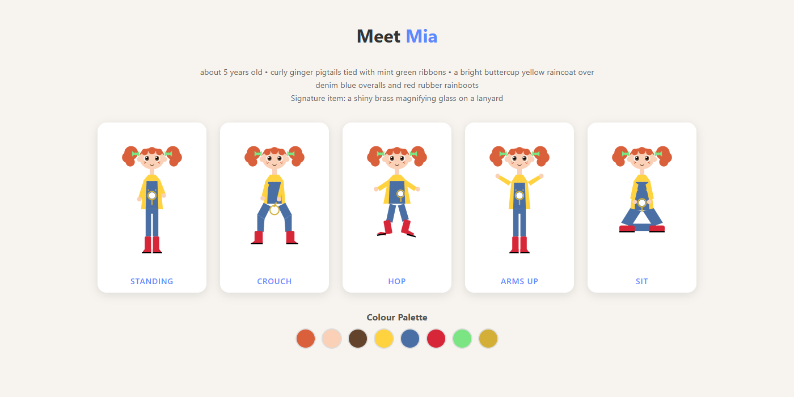
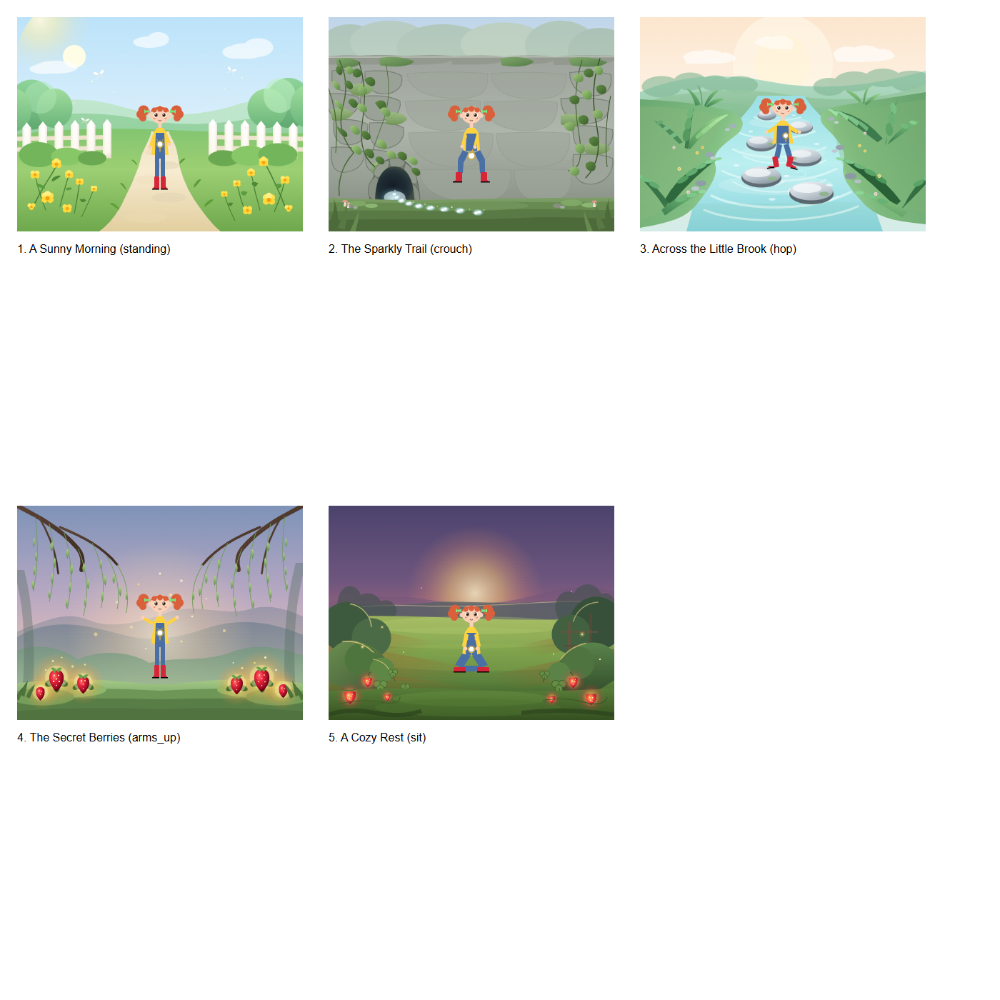
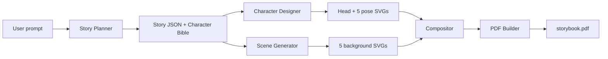

# 📖 Storybook Agent

**Turn a single sentence into a fully illustrated, five-page children's book, with a main character who looks identical on every page.**


---

## Overview

Storybook Agent is a multi-stage AI pipeline. Given one prompt, it plans a structured story, designs a reusable character, illustrates five scenes, and exports a clean, downloadable PDF.

The hard problem in AI-illustrated books is **character consistency**: image models tend to redraw the hero differently on every page. This project solves it structurally. The character is generated **once** and the exact same artwork is reused on every page.

> **Demo prompt:** *"Create a five-page children's book story outlining a young, brave character discovering a hidden, magical garden."*

## Demo

📄 **[Sample output PDF](samples/storybook_sample.pdf)**


*One character, five poses. The head artwork is identical in every pose.*


*The five generated scenes with the same character composed onto each.*

## Key Features

- **Single-prompt input.** One sentence in, finished book out.
- **Structured planning.** A five-beat story arc (meet, discover, challenge, magic, resolution) validated with Pydantic.
- **Character Bible.** Fixed appearance details plus a strict hex colour palette shared by every stage.
- **Guaranteed visual consistency.** The character is generated once and reused unchanged on every page.
- **Validated LLM output.** Every generated SVG is parsed, checked against an allow-list, and retried with the error fed back if invalid.
- **Resilient API layer.** Exponential-backoff retries for rate limits and overload errors (429/503).
- **Cached, re-runnable stages.** Finished assets are reused, so re-runs do not burn API quota.
- **Provider-agnostic LLM wrapper.** Text generation sits behind a single interface (`agent/llm.py`).

## How It Works



| Stage | Module | What it does |
|---|---|---|
| 1. Plan | `agent/planner.py` | Prompt to a validated `Story`: 5 pages, character bible with palette, one pose per page |
| 2. Design | `agent/character.py` | Generates one shared head and five body poses as SVG, validated against the palette |
| 3. Scene | `agent/scene.py` | Generates a character-free 800x600 background per page, validated against a tag allow-list |
| 4. Compose | `agent/compose.py` | Places the character on the ground line of each scene |
| 5. Publish | `agent/pdf_builder.py` | Builds the cover and five story pages with ReportLab + svglib |

## How Character Consistency Is Guaranteed

1. **One source of truth.** The Character Bible (appearance, outfit, hex palette) is created once by the planner.
2. **Generate once, reuse everywhere.** The character is drawn a single time as a shared head plus five body poses. The same head markup is used in every pose.
3. **Byte-identical composition.** The compositor inserts the stored SVG file unchanged. Nothing is regenerated per page, so the character cannot drift.
4. **Validation at the source.** Colours are checked against the palette, and unsafe or unsupported SVG elements are rejected.

## Tech Stack

| Area | Tools |
|---|---|
| Language | Python 3.11+ |
| LLM | Google Gemini via `google-genai` |
| Schemas and validation | Pydantic |
| Reliability | Tenacity (retries with backoff) |
| PDF | ReportLab, svglib |
| CLI output | Rich |

## Project Structure

```
storybook-agent/
├── agent/
│   ├── config.py        # environment and model configuration
│   ├── schemas.py       # Pydantic models: Story, Page, CharacterBible
│   ├── llm.py           # provider-agnostic text generation wrapper
│   ├── planner.py       # story planning
│   ├── character.py     # character SVG generation
│   ├── scene.py         # background SVG generation
│   ├── compose.py       # character + background composition
│   └── pdf_builder.py   # PDF assembly
├── docs/                # design doc and README images
├── samples/             # sample generated PDF
├── main.py              # plan + character stages (CLI)
├── run_m4.py            # backgrounds + page composition
├── run_pdf.py           # PDF export
└── requirements.txt
```

## Getting Started

### Prerequisites
- Python 3.11 or newer
- A Google Gemini API key from [Google AI Studio](https://aistudio.google.com/apikey)

### Installation
```bash
git clone https://github.com/arihant2207/storybook-agent.git
cd storybook-agent
python -m venv venv
venv\Scripts\activate        # Windows
# source venv/bin/activate   # macOS / Linux
pip install -r requirements.txt
```

### Configuration
```bash
copy .env.example .env       # Windows
# cp .env.example .env       # macOS / Linux
```
Open `.env` and add your API key and model names.

| Variable | Description |
|---|---|
| `GEMINI_API_KEY` | Your Gemini API key (never commit this file) |
| `TEXT_MODEL` | Gemini model used for planning and SVG generation |
| `VISION_MODEL` | Reserved for the planned consistency checker |
| `IMAGE_MODEL` | Reserved for a future image-generation provider |

Model names change over time, so use one that is available to your key.

### Run
```bash
python main.py "Create a five-page children's book story about a young, brave character discovering a hidden, magical garden"
python run_m4.py
python run_pdf.py
```
The result is written to `output/storybook.pdf`.

To generate a **new** story, add `--fresh` to the first command and delete `output/backgrounds` and `output/pages` before running `run_m4.py` (finished assets are cached).

## Design Decisions

**Why SVG instead of generated images?** Diffusion models do not guarantee the same character across separate generations, and image-generation quota was unavailable on the API key used for development. Generating the character as SVG once and reusing it makes consistency a property of the system rather than something to hope for. The LLM layer is isolated, so an image-generation provider can be added later.

**Why a Character Bible?** One structured object is the single source of truth for appearance and colours, so every stage works from identical data.

**Why validate everything?** LLM output is untrusted. Pydantic validates the story and SVG output is parsed, allow-listed and retried on failure, which makes the pipeline predictable.

## Limitations and Roadmap

Current limitations:
- Flat vector illustration style, not painted artwork.
- LLM-generated SVG backgrounds occasionally need a regeneration (delete the file in `output/backgrounds` and rerun).
- Consistency is structural, not scored; there is no automated visual check yet.
- The pipeline runs as three commands rather than one.
- Page length and art style are not yet user-configurable.

Roadmap:
- [ ] Vision-model consistency scoring